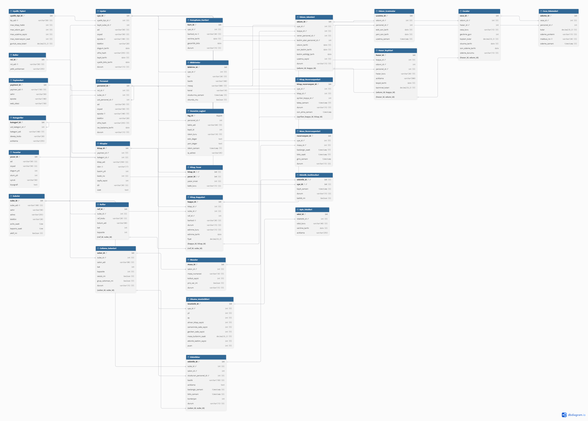

# 📚 BAĞDAT - Akıllı Kütüphane ve Materyal Yönetim Sistemi

**Veritabanı Yönetim Sistemleri (VYS) Dönem Projesi**


BAĞDAT; üniversite ve şehir kütüphanelerinin kitap, yazar, yayınevi, nüsha ve üye yönetimini tek bir ilişkisel veritabanında toplayan bir kütüphane otomasyon sistemidir. Sistem; veri bütünlüğünü sağlamak ve anlık durum takibi yapmak amacıyla tetikleyiciler (triggers), saklı yordamlar (stored procedures), görünümler (views) ve kısıtlar (constraints) kullanılarak PostgreSQL üzerinde tasarlanmıştır.

## 📑 İçindekiler

- [Çözülen problem](#-çözülen-problem)
- [Temel özellikler](#-temel-özellikler)
- [Proje grubu ve iş bölümü](#-proje-grubu-ve-iş-bölümü)
- [Veri modeli](#-veri-modeli)
- [Teknik tasarım kararları](#-teknik-tasarım-kararları)
- [Kurulum ve çalıştırma](#-kurulum-ve-çalıştırma)
- [Test süreci](#-test-süreci)
- [Klasör yapısı](#-klasör-yapısı)
- [Çalışma düzeni](#-çalışma-düzeni)
- [Proje durumu](#-proje-durumu)
- [Dokümanlar ve veri kaynakları](#-dokümanlar-ve-veri-kaynakları)

## 🎯 Çözülen problem

Geleneksel kütüphane sistemlerinde kitap takibi düzensizdir, iade ve ceza süreçleri elle yürütülür, masa ve salon doluluğu anlık görülemez. BAĞDAT bu sorunları şöyle çözer:

| Sorun | BAĞDAT'ın çözümü |
|---|---|
| Sistemde "mevcut" görünen kitap rafta bulunamaz, teslim süresi geçse de ceza takibi yapılmaz | Her fiziksel nüsha ayrı tutulur; iade ve gecikme cezası saklı yordamlarla otomatik işlenir |
| Öğrenci gelmeden salon ve masa doluluğunu göremez | Masa ve salon rezervasyonları veritabanında tutulur; saat çakışmaları kısıtlarla engellenir |
| Kitap hasar görürse veya kaybolursa sorumluluk ve tazminat belirsizdir | Hasar kaydı ödünç kaydına bağlanır; ceza ve ödemeler ayrı kaydedilir |

## ✨ Temel özellikler

- 📖 Kitap başlığı (`Kitaplar`) ile rafta duran fiziksel nüsha (`Kitap_Kopyalari`) ayrı yönetilir
- 🔄 Ödünç verme, iade ve süre uzatma işlemleri **saklı yordamlarla tek işlem (transaction)** olarak yürütülür
- 💸 Gecikme ve hasar cezaları ödünç kaydına bağlanır; **ödenmemiş cezası olan üye yeni ödünç alamaz**
- 🔖 Kitap rezervasyonları; süresi dolunca zamanlanmış görevle kapatılır
- 🪑 Çalışma masası rezervasyonlarında **saat çakışması veritabanı kısıtıyla engellenir**
- 🎟️ Etkinlik kaydı ve kontenjan yönetimi
- 🏆 Okuma istatistiklerine dayalı aylık ödül arşivi
- ⚙️ Üyelik kuralları (kitap hakkı, süre, uzatma sayısı, günlük ceza) kodun içinde değil `Uyelik_Tipleri` tablosunda tutulur; program değiştirmeden güncellenebilir
- 🕵️ Personelin kritik değişiklikleri `Denetim_Loglari` tablosuna kaydedilir

**Hedef kullanıcılar:** üyeler (öğrenci, akademisyen), kütüphane personeli ve yönetici.

## 👥 Proje grubu ve iş bölümü

| Ekip üyesi | Sorumlu modül |
|---|---|
| İrem Çelik | Modül 1: Üyelik, personel ve sistem |
| Hayrunnisa Sarı | Modül 2: Katalog ve envanter |
| Saliha Esma Sönmezsoy | Modül 3: Dolaşım |
| Medine Gül Enser | Modül 4: Çalışma alanları ve okuma teşviki |

Ortak işler (depo düzeni, kurulum, şema birleştirme, rapor, sunum) ve grup görevleri (modüller arası görünümler, performans, negatif testler, demo) ekip olarak yürütülür. Görev takibi Jira üzerinden yapılır.


## 🗂️ Veri modeli

Model **4 modülde toplam 28 tablodan** oluşur. Merkezde `Uyeler` ve `Kitap_Kopyalari` vardır; aralarındaki çoka çok ilişki `Odunc_Islemleri` ara varlığıyla çözülür. Beş çoka çok ilişkinin tamamı ara varlıkla çözülmüştür.

| Modül | Tablolar |
|---|---|
| **1. Üyelik, personel ve sistem** (8) | `Uyelik_Tipleri`, `Uyeler`, `Subeler`, `Kutuphane_Kartlari`, `Roller`, `Personel`, `Bildirimler`, `Denetim_Loglari` |
| **2. Katalog ve envanter** (7) | `Yayinevleri`, `Kategoriler`, `Yazarlar`, `Kitaplar`, `Kitap_Yazar`, `Raflar`, `Kitap_Kopyalari` |
| **3. Dolaşım** (6) | `Odunc_Islemleri`, `Odunc_Uzatmalar`, `Kitap_Rezervasyonlari`, `Cezalar`, `Ceza_Odemeleri`, `Hasar_Kayitlari` |
| **4. Çalışma alanları ve okuma teşviki** (7) | `Calisma_Salonlari`, `Masalar`, `Masa_Rezervasyonlari`, `Etkinlikler`, `Etkinlik_Katilimcilari`, `Okuma_Istatistikleri`, `Ayin_Odulleri` |

### ER diyagramı

<!-- TODO: docs/er.png dosyasını ekledikten sonra aşağıdaki satırın başındaki işareti kaldırın -->
<!--  -->

ER diyagramı [dbdiagram.io](https://dbdiagram.io) ile hazırlanmıştır. DBML kaynağı `docs/er.dbml` dosyasındadır.

## 🧠 Teknik tasarım kararları

- **Nüsha ayrımı:** Kitabın başlık bilgisi ile fiziksel nüsha ayrı tutulur; böylece her nüshanın durumu, rafı ve şubesi ayrı ayrı bilinir.
- **Bileşik yabancı anahtarlar:** `Raflar`–`Kitap_Kopyalari`, `Hasar_Kayitlari`–`Odunc_Islemleri`, `Cezalar`–`Hasar_Kayitlari`, `Kitap_Rezervasyonlari`–`Kitap_Kopyalari` ve `Etkinlikler`–`Calisma_Salonlari` ilişkilerinde kullanılır. Birbirine bağlı iki bilgi (örneğin kopyanın şubesi ile rafın şubesi) tetikleyiciye gerek kalmadan tutarlı kalır.
- **Kısmi benzersiz indeksler:** Bir nüshanın aynı anda yalnızca bir açık ödünç kaydı olabilir; üye başına aynı anda yalnızca bir aktif kütüphane kartı bulunabilir.
- **Çakışma kısıtı:** Masa rezervasyonlarında saat çakışmaları veritabanı kısıtlarıyla önlenir.
- **Saklı yordamlar:** Ödünç verme, iade, süre uzatma ve masa rezervasyonu tek işlem olarak yürütülür.
- **Kuralların veride tutulması:** Üyelik kuralları `Uyelik_Tipleri` tablosundadır; kodda sabit değer yoktur.
- **Bilinçli türetilmiş tablo:** `Okuma_Istatistikleri`, performans için tutulan bir özet tablodur ve ay sonunda yordamla doldurulur.
- **Denetim:** Personelin kritik değişiklikleri `Denetim_Loglari` tablosuna kaydedilir.

## 🚀 Kurulum ve çalıştırma

**Gereksinimler:** PostgreSQL (sürümü buraya yazın, örn. 16) ve `psql` komut satırı aracı.

> ⚠️ Bu bölüm, ilgili dosyalar depoya eklendikçe doğrulanmalıdır. Komutlar planlanan klasör yapısına göredir.

```bash
# 1. Depoyu klonlayın
git clone <depo-adresi>
cd <depo-klasoru>

# 2. Veritabanını oluşturun
createdb bagdat

# 3. Tüm şemayı, mantığı ve örnek veriyi kurun
psql -d bagdat -v ON_ERROR_STOP=1 -f sql/install.sql
```

Gerekli PostgreSQL eklentileri (`btree_gist`, `pgcrypto` vb.) `sql/00_setup.sql` içinde açılır. Windows kullanıyorsanız komutları Git Bash veya WSL içinde çalıştırın.

## ✅ Test süreci

Testler ek kütüphane gerektirmeden `psql` ile çalışır. Her test dosyası bir işlem içinde çalışır ve sonunda `ROLLBACK` yapar, yani veritabanını kirletmez. Hem olumlu hem de **reddedilmesi gereken** durumlar test edilir.

```bash
# Temiz veritabanı kur ve tüm testleri çalıştır
bash tests/run_all.sh
```

Test dosyası adı kuralı: `tests/modulX/BAG-N_test.sql`.

## 📁 Klasör yapısı

```
bagdat/
├── README.md
├── CONTRIBUTING.md
├── docs/            # rapor, ER diyagramı, sunum, demo senaryosu
├── sql/
│   ├── 00_setup.sql
│   ├── install.sql              # tüm modülleri doğru sırayla kurar
│   ├── 01_modul1/               # üyelik, personel, sistem
│   ├── 02_modul2/               # katalog ve envanter
│   ├── 03_modul3/               # dolaşım
│   ├── 04_modul4/               # çalışma alanları ve okuma teşviki
│   └── 96_… 99_                 # performans, çapraz sorgular, görünümler, roller
├── data/            # örnek veri dosyaları (CSV) ve kaynak notları
├── tools/           # veri üretim betikleri
└── tests/           # run_all.sh ve modül testleri
```

## 🤝 Çalışma düzeni

Her görev için aynı akış izlenir:

1. Jira'da görev "Devam Ediyor" yapılır; her görevin tek bir atanan kişisi vardır.
2. `main` güncellenir ve görev için dal açılır: `feature/BAG-11-odunc-yordamlari`
3. Küçük ve sık commit atılır. Mesaj biçimi: `BAG-11: sp_iade_al gecikme cezası eklendi`
4. Görevin test dosyası yazılır ve `bash tests/run_all.sh` yerelde geçer.
5. Pull request açılır; ekipten başka biri inceler, dalı çekip testleri çalıştırır.
6. En az 1 onay ve geçen testlerden sonra `main`'e birleştirilir; Jira'da görev "Bitti" olur.

`main` dalına doğrudan push yapılmaz. Ayrıntılar için `CONTRIBUTING.md` dosyasına bakın.

## 📈 Proje durumu

<!-- TODO: İlerledikçe işaretleyin -->

| Modül | Tablolar | Örnek veri | İş mantığı | Testler |
|---|---|---|---|---|
| 1. Üyelik, personel, sistem | ⬜ | ⬜ | ⬜ | ⬜ |
| 2. Katalog ve envanter | ⬜ | ⬜ | ⬜ | ⬜ |
| 3. Dolaşım | ⬜ | ⬜ | ⬜ | ⬜ |
| 4. Çalışma alanları, okuma teşviki | ⬜ | ⬜ | ⬜ | ⬜ |

✅ tamamlandı · 🟨 devam ediyor · ⬜ başlanmadı

## 📎 Dokümanlar ve veri kaynakları

- 📄 Proje uygulama planı: `docs/BAGDAT_Proje_Plani.pdf`
- 🗺️ ER diyagramı: `docs/er.png`, `docs/er.dbml`
- 📊 Proje raporu: `docs/rapor.pdf` 

**Örnek veri kaynakları:** Kullanılan veri setlerinin adı, bağlantısı, lisansı ve dönüştürme adımları `data/README.md` dosyasında belirtilir. Üye ve personel verileri gerçek kişilere ait değildir; üretilmiştir.

## 🛠️ Teknolojiler

- **Veritabanı:** PostgreSQL (tablolar, kısıtlar, indeksler, saklı yordamlar, tetikleyiciler, görünümler, transaction)
- **Sürüm kontrolü:** Git ve GitHub
- **Proje yönetimi:** Jira
- **Modelleme:** dbdiagram.io
